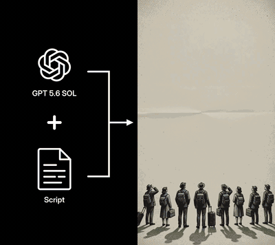

# Vox Style Collage Video

Agent skill for turning scripts, beat lists, or fact lists into Vox-style
paper-collage explainer videos.

## Demo



This skill is intended for **Claude**, **OpenClaw**, and **Hermes Agent** style
skill runtimes. It is built around the **Unsora MCP** toolset from
[Unsora](https://tryunsora.com/), which is required for image, video, music
generation, and optional social posting. Prompt-only requests and assembly of existing media can be completed without that connection.

## Prerequisites (only for the requested stages)

- A compatible agent runtime: Claude, OpenClaw, or Hermes Agent
- For generation: Unsora MCP connected and authenticated from [tryunsora.com](https://tryunsora.com/)
- For generation: available Unsora credits for image, video, and optional music generation
- For assembly: `ffmpeg` and `ffprobe` available locally for assembly, timing, and mixing
- For narrated films: a voiceover source, either supplied audio or a separate session TTS tool

Unsora is deliberately **not** used for narration because Unsora has no TTS. The
voiceover must come from a supplied audio file or another TTS tool connected to
the session.

## What It Does

The skill defines a narration-first production workflow using:

- Unsora MCP image generation for hero frames and reference sheets
- Unsora MCP video generation for limited-frame cutout animation
- Unsora MCP music generation for editorial underscoring
- External voiceover or session TTS for narration
- ffmpeg for timing, assembly, and final mix

## Contents

- `SKILL.md` - main skill instructions and workflow
- `references/style-dna.md` - visual system, prompt templates, and style checks
- `references/pipeline.md` - generation, voiceover, ffmpeg, and delivery pipeline
- `references/beat-mapping.md` - narration segmentation and shot mapping

## Usage

Install or copy this folder into your agent's skills directory, then invoke it
for Vox-style, editorial collage, or paper-collage explainer video work.

Before generation, confirm that Unsora MCP exposes the tools needed for the requested stages:

- `create_image` / `wait_for_image`
- `create_video` / `wait_for_video`
- Optional approved music: `create_music` / `wait_for_music`
- Optional for account checks or explicitly requested posting: `get_subscription`, `get_credits`, `get_accounts`, `create_post`, `list_posts`

## Local validation

Python 3.10+ can validate a completed manifest without generation:

```sh
python3 scripts/prepare_timeline.py /path/to/project/shots.json --probe --output-dir /path/to/project/assembly-01
python3 -m unittest discover -s tests -v
```

`--probe` requires ffprobe. Output order follows the manifest; unfinished/missing clips, stale totals and narration that exceeds its edit window are rejected. The output directory must be new, so previous edits are preserved. Without `--probe`, durations are declared rather than measured.

The offline tests use temporary synthetic files and require no Unsora credentials or credits. CI additionally exercises the documented audio graph with synthetic FFmpeg sources. Live Unsora model support, credit usage, generation quality and posting remain unverified by these checks. Model and parameter examples must be checked against the connected tool schema before use.
